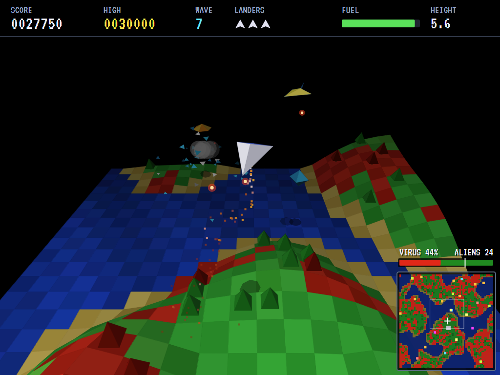
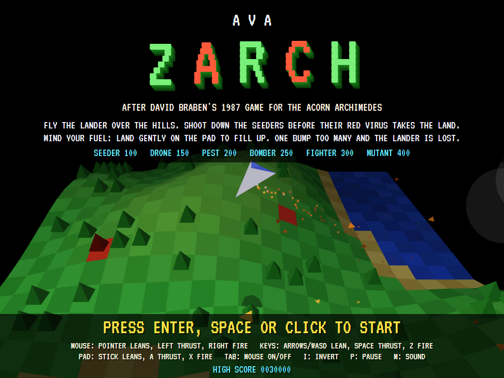
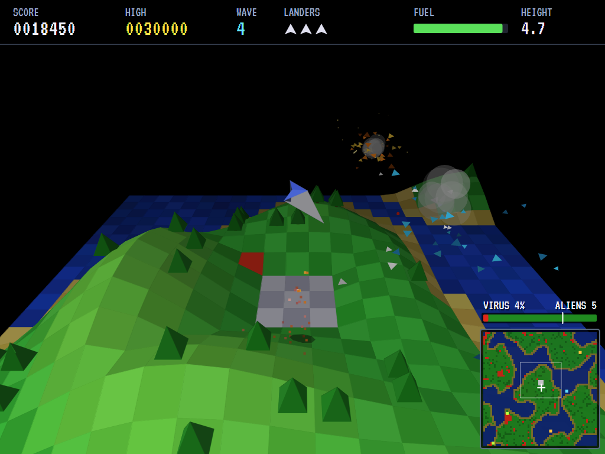
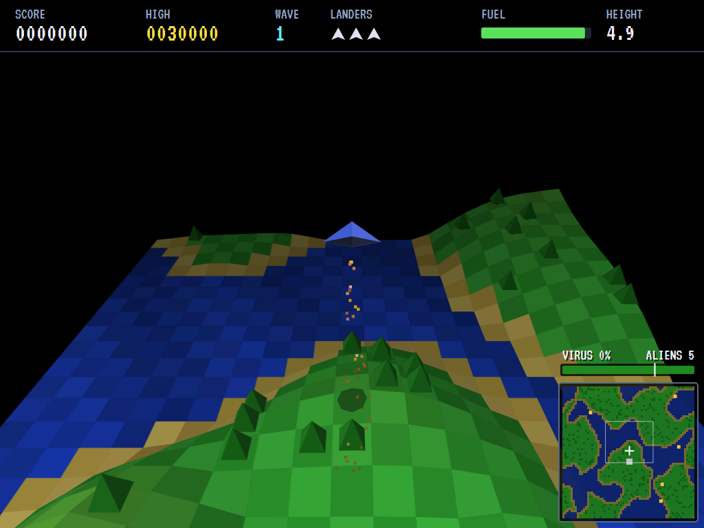

# AVA Zarch

[](https://github.com/Harlock123/AVAZarch/actions/workflows/build.yml)

A lander shooter in the style of David Braben's 1987 Acorn Archimedes game **Zarch** (released on the Amiga,
Atari ST and PC as **Virus**), built with .NET 10 and Avalonia UI. A patch of solid, flat-shaded 3D landscape
(rolling green hills, the sea, beaches and a launch pad) scrolls under a little lander seen from behind and
above. Alien seeders fly over it dropping a red virus that turns the land red and kills the trees. Take off,
hunt them down before the land is overrun, and mind your fuel: the only place to fill up is the pad, and only
if you can set the lander down gently.

## Features

- **A solid 3D land:** a square of 64×64 tiles that wraps round at every edge, its hills, valleys, sea and
  beaches drawn as filled polygons, each square shaded by how it faces the light and fading into the dark
  with distance. Only the patch round the lander is drawn, floating in black, as in the original. Trees
  stand on the grass, and a flat grey pad sits on a rise in the middle.
- **Real lander physics:** gravity, inertia and drag; the engine pushes along the lander's own up, so leaning
  it and firing the engine is how you move, and leaning further pushes harder sideways and less upwards. Let
  go and it levels out. The air thins up high and the engine gives out.
- **Fuel and landing:** thrust burns fuel; set the lander down gently on the pad to fill up. Coming down too
  hard, too fast, leaning too far, or on the sea wrecks it. You can land on grass to rest, but only the pad
  refuels.
- **The gun fires along the nose,** which dips as the lander leans forward: lean towards a target to aim
  down at it, or level off to fire straight ahead.
- **The virus:** seeders drop spores that turn the square they land on red, and the infection creeps slowly
  into the land next to it. Trees on infected squares die. If the virus takes 70% of the land, the game is
  lost. Each wave cleared earns 50 points for each per cent of the land still clean, and the land heals a
  little between waves.
- **Six kinds of alien:** seeders (100), drones that drift about and shoot when you come near (150), pests
  that skim from infected land to clean land, spreading the virus (200), bombers that fly high and drop bombs
  infecting a whole patch at once (250), fighters that hunt the lander and fire at it (300), and mutants
  (400): what a seeder left alone too long becomes, fast and erratic and out to ram you.
- **Waves:** a wave ends when every alien is shot down. Each wave brings more, and new kinds join as they go
  on; the aliens get faster and quicker to fire.
- **Particles:** shards of debris that bounce on the ground, smoke, sparks, spray off the sea, and a stream
  of burning exhaust falling from the engine.
- **The scanner:** the whole land at a glance, centred on the lander and wrapping like the world: grass, sea,
  the pad, the infection in red, every alien, and the patch on screen. A bar shows how much of the land the
  virus holds, and where the game is lost.
- **Three landers,** and another for every 10 000 points.
- **Mouse, keys or gamepad.** As in the original, the mouse is the way to fly: the pointer's distance and
  direction from the middle of the screen set how far and which way the lander leans; the left button is
  the engine and the right the gun.
- **The demonstration** shows the computer pilot at work: it flies with the lean and the engine just as a
  player does, climbs above an alien, points the nose at where it will be and fires, dodges the aliens'
  shots, and flies home to land on the pad when its fuel runs low.
- **Sound:** the engine's roar, shots, blasts, spores and bombs, all synthesised; the title music is the
  opening of Bach's *Toccata and Fugue in D minor* on a small synthesised organ.

## Screenshots

| The virus spreading | The title |
|:-------------------:|:---------:|
|  |  |
| Wave 7: seeders, a fighter, and the land turning red. | The computer pilot flying behind the title. |

| A seeder shot down | Off the pad |
|:------------------:|:-----------:|
|  |  |
| Debris and smoke. | Out over the sea, exhaust falling. |

The screenshots are made by the tests, which play the game in a real (headless) window; see
[Tests](#tests).

## Download and run

Ready-to-run builds for Windows, macOS and Linux, on both Intel/AMD and ARM, are on the
[Releases page](https://github.com/Harlock123/AVAZarch/releases/tag/latest). **Latest build** is
rebuilt on every push to `main`. Each download is one self-contained executable: no .NET install is
needed.

| Platform | Archive |
|---|---|
| Windows | `AVAZarch-win-x64.zip`, `AVAZarch-win-x86.zip`, `AVAZarch-win-arm64.zip` |
| macOS | `AVAZarch-osx-arm64.tar.gz` (Apple silicon), `AVAZarch-osx-x64.tar.gz` (Intel) |
| Linux | `AVAZarch-linux-x64.tar.gz`, `AVAZarch-linux-arm64.tar.gz`, `AVAZarch-linux-arm.tar.gz` |

```bash
tar -xzf AVAZarch-linux-x64.tar.gz     # or linux-arm64, linux-arm, osx-arm64, osx-x64
./AVAZarch
```

On Windows, unzip and run `AVAZarch.exe`. On macOS, if Gatekeeper refuses to open it, run
`xattr -d com.apple.quarantine AVAZarch` once. Run with `--no-audio` for silence.

**Sound** comes through OpenAL Soft, built in for every platform. In a virtual machine the game
detects it and uses a larger audio buffer, so the sound doesn't break up.

**Gamepads** use SDL2, which is bundled for Windows, macOS and Intel/AMD Linux. ARM Linux builds need it
installed; without it the keyboard and mouse still work:

```bash
sudo apt install libsdl2-dev            # Debian / Ubuntu / Raspberry Pi OS
sudo pacman -S --needed sdl2-compat     # Arch / Omarchy
```

## Controls

| Action | Mouse | Keyboard | Gamepad |
|---|---|---|---|
| Start | Click | Enter, 1, Space or Z | Start or A |
| Lean the lander | Pointer away from the middle of the screen | Arrows or WASD (Up leans away, north) | Left stick / D-pad |
| Engine (thrust) | Left button | Space, Shift or X | A or right trigger |
| Fire | Right button | Z or Ctrl | X, B or right bumper |
| Mouse on/off | | Tab | |
| Invert up and down | | I | Y |
| Pause | | P or Esc | Start or Back |
| Sound on/off | | M | |
| Screenshot | | Ctrl+S (to your Pictures folder) | |

The further the pointer is from the middle, the further the lander leans; a ring on screen shows the
steepest lean. Holding a key or the stick takes over from the mouse until the mouse moves again. On the
high-score table, type your initials, or use up/down and Space, then Enter.

**How to fly:** thrust straight up to lift off. Lean the way you want to go and blip the engine; the
lander keeps its speed, so lean the other way to stop. To land, come down slowly and level. Lean towards
an alien below you to point the gun at it.

## Tests

```bash
dotnet test AVAZarch.slnx
```

The game runs in fixed 60 Hz steps, so it plays the same at any frame rate. The tests check:

- **The land:** it wraps round at every edge without a seam, and distances take the short way round; there
  are hills, sea at sea level, beaches, and a flat pad; grass can be infected but not the sea or the pad;
  left alone the virus creeps into the land next to it; a third of it heals between waves.
- **Flying:** on the pad the lander sits still and fills up; thrust lifts it and burns fuel; without thrust
  it falls and keeps its way; leaning and thrusting drives it that way with the nose dipped, never past the
  steepest lean, and let go it levels out; a gentle touchdown lands it, but too hard, too fast, leaning too
  far or on the sea wrecks it; grass doesn't refuel; out of fuel the engine is dead; the engine gives out up
  high; off one edge of the world and back at the other.
- **Fighting:** the gun fires along the nose and keeps firing while held, and leaning sends the shots down;
  a shot brings down a seeder in front and misses one to the side; bombers and fighters take two; shots
  reach across the edge of the world; seeders drop spores that infect the land below; trees on infected
  squares die; a seeder left alone mutates; pests spread the virus from infected land; a bomb infects a
  patch; fighters close in and fire; an alien's shot destroys the lander unless it's untouchable; ramming
  takes both; aliens never fly into the land; waves grow and new kinds join.
- **The game:** it starts on the pad with the wave called; clearing a wave gives the bonus for the land
  saved and calls the next; a lost lander costs a life and the next goes up from the pad, fuelled and
  untouchable for a moment; the last one lost ends the game, a good score gets initials and is kept; the
  virus taking 70% of the land loses the game; extra landers; pause; the title, the demonstration and the
  scores; the demonstration is silent; every sound has its file.
- **The view:** north is up the screen and east is right, further is smaller, the lander is in the middle,
  places round the wrap are drawn where they're nearest, and the camera follows the lander up and down
  lazily.
- **The controls,** through the input handler: Up and thrust fly it north and up the screen, Down south,
  Left and Right west and east; Space, Shift and X thrust, Z and Ctrl fire; inverted, up leans back; the
  pointer leans it from the middle of the screen, the left button thrusts and the right fires, and the
  keys take over until the mouse moves again; a Shift let go as Caps Lock is let go.
- **The computer pilot** clears the first wave without losing a lander, lives through long games and keeps
  scoring, and flies home to land on the pad when low on fuel.

`tests/AVAZarch.Tests/PilotProbe.cs` reports how the computer pilot gets on over whole games, for tuning
(`ZARCH_PROBE=1`, or a wave number to start there; `ZARCH_SEEDS=1,2,3`).

The screenshot tests draw the real screen in a headless window. To refresh the README's pictures:

```bash
ZARCH_SHOTS=$PWD/Images dotnet test tests/AVAZarch.Tests --filter ScreenshotTests
```

## Building

```bash
dotnet build AVAZarch.slnx
dotnet run --project src/AVAZarch
```

Needs the .NET 10 SDK. The sounds and music are made by `tools/make_sounds.py` (standard-library Python):
`python3 tools/make_sounds.py` rewrites `src/AVAZarch/Sounds`.

## Project structure

```
AVAZarch/
├── AVAZarch.slnx
├── src/AVAZarch/
│   ├── Engine/
│   │   ├── GameEngine.cs        # States, waves, losing a lander, the land overrun, the scores
│   │   ├── Sim.cs               # The lander's flight, its gun, the aliens, spores and bombs, particles
│   │   ├── Land.cs              # The wrapping landscape, the pad, the sea, the trees and the virus
│   │   ├── World.cs             # The measures, and the lander, aliens, missiles and particles
│   │   ├── View.cs              # The camera and the projection
│   │   ├── Pilot.cs             # The computer player (the demonstration, and the tests)
│   │   ├── HighScoreTable.cs, InitialsEntry.cs
│   │   ├── InputHandler.cs, ControllerManager.cs  # Mouse, keys and an SDL2 gamepad
│   │   └── SoundManager.cs      # Effects, the engine's roar and the music through OpenAL
│   ├── Audio/                   # The OpenAL engine (from the author's AVABand)
│   ├── Views/                   # The drawing: the land row by row, the shapes, particles, scanner, HUD
│   └── Sounds/                  # The synthesised effects and music
├── tests/AVAZarch.Tests/        # Land, flight, combat, game, view, input, pilot and screenshot tests
├── tools/make_sounds.py
└── Images/                      # Screenshots
```

## About and licence

AVA Zarch © 2026 Lonnie Watson, under the [MIT License](LICENSE).

*Zarch* (1987) and *Virus* (1988) are David Braben's games; the names belong to their owners. AVA Zarch
is an independent, unofficial game in their style. Its land, lander, aliens, graphics, sounds and code are its
own; nothing is taken from the original game's program, graphics or sound. It is not affiliated with or
endorsed by any rights holder.

The title music is the opening of Johann Sebastian Bach's *Toccata and Fugue in D minor*, BWV 565, which is in
the public domain, arranged here for the program's own synthesised organ; the jingles are new.

The [VT323](https://fonts.google.com/specimen/VT323) font is by Peter Hull, under the SIL Open Font License
(`src/AVAZarch/Assets/Fonts/VT323-OFL.txt`). Sound plays through [OpenAL Soft](https://openal-soft.org/)
(LGPL; `src/AVAZarch/Audio/native/COPYING-openal-soft.txt`).
